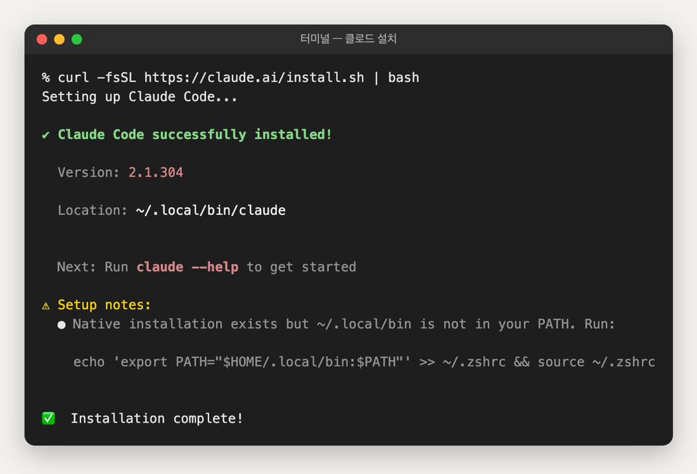
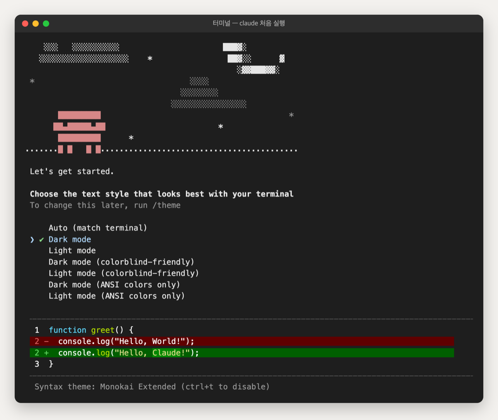
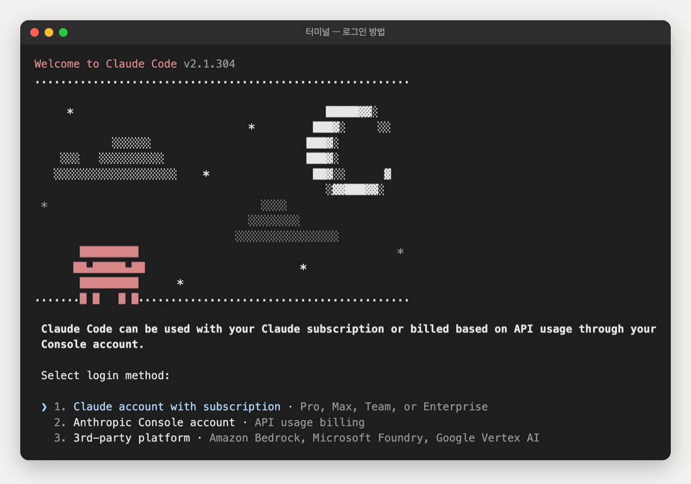
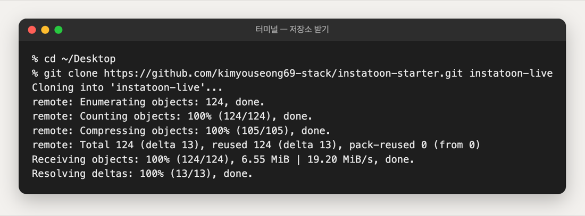
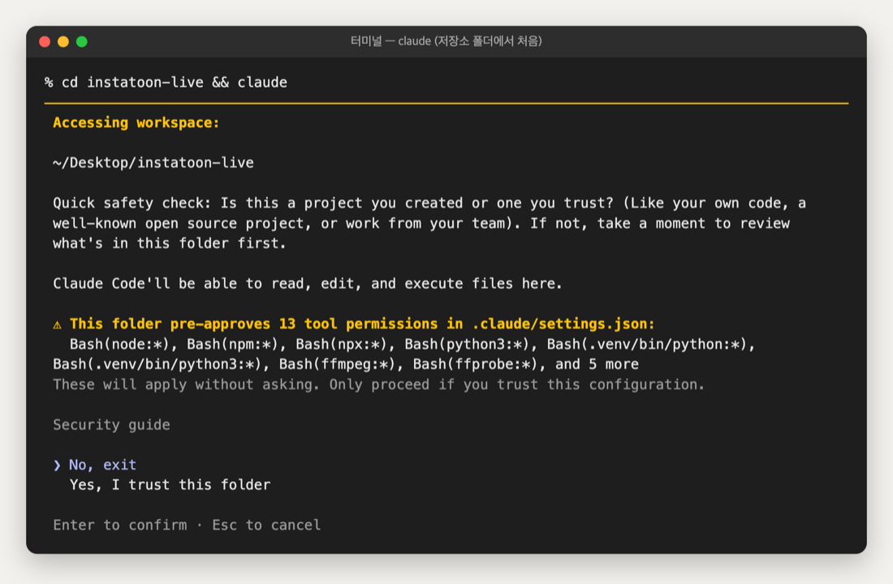
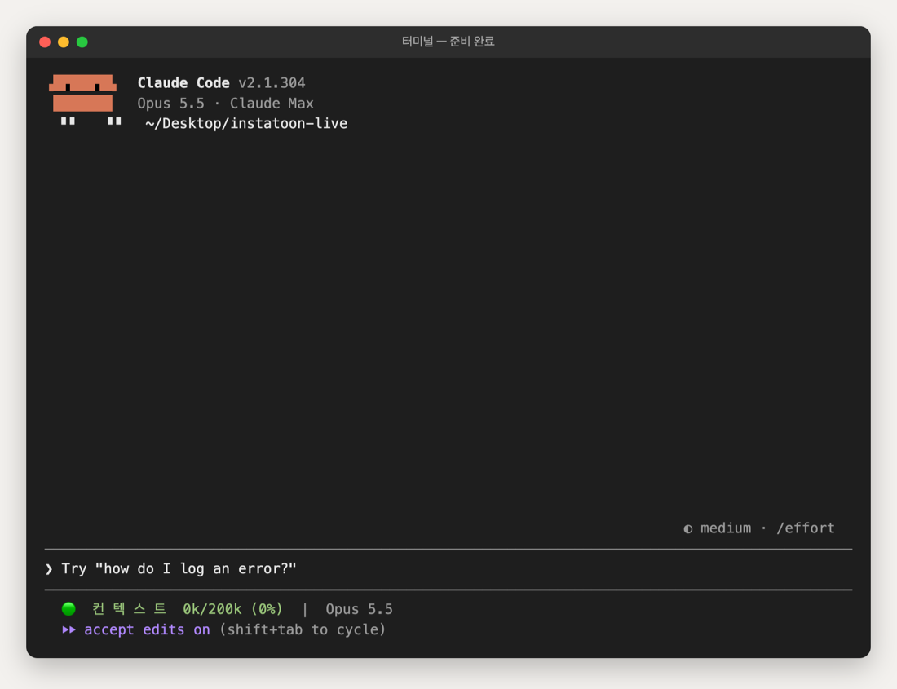
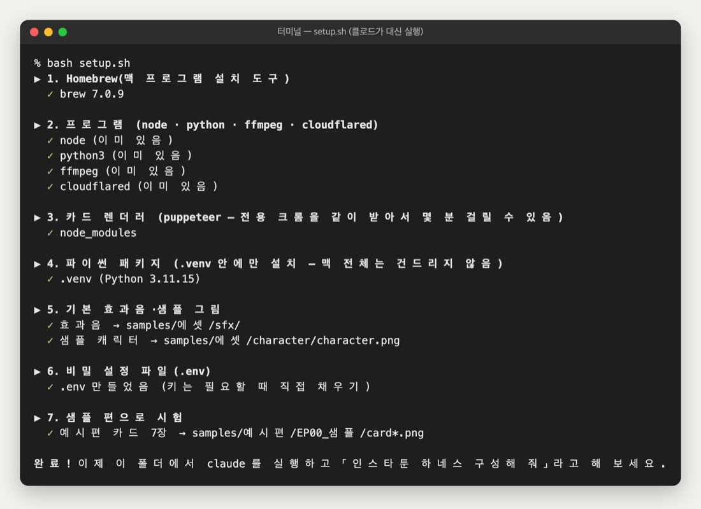

# 1. 처음 설치 (맥, 한 번만)

아무것도 없는 맥에서 시작해요. 아래 그림은 **실제로 설치하면서 찍은 화면**이에요(2026-10-20, Claude Code 2.1.304). 버전이 바뀌면 글자가 조금 다를 수 있어요.
막히면 화면에 나온 글자를 그대로 클로드에게(또는 ChatGPT 에게) 보여 주세요.

## ① 터미널 열기
`command + space` → 「터미널」 입력 → 엔터. 창이 뜨면 여기에 명령을 붙여 넣고 엔터를 쳐요.
> 터미널은 「클로드에게 말 거는 창」일 뿐이에요. 명령은 복사해서 붙여 넣으면 돼요.

## ② Homebrew 설치 (맥 프로그램 설치 도구)
```bash
/bin/bash -c "$(curl -fsSL https://raw.githubusercontent.com/Homebrew/install/HEAD/install.sh)"
```
- 맥 로그인 비밀번호를 물어보면 입력해요(**입력해도 화면에 안 보이는 게 정상**이에요).
- 끝에 「Next steps」로 나오는 두 줄(`echo ... >> ~/.zprofile`, `eval ...`)도 복사해서 실행해요.
- 이때 개발자 도구(git 등)도 함께 설치돼요. 몇 분 걸려요.

## ③ Claude Code 설치
```bash
curl -fsSL https://claude.ai/install.sh | bash
```


**★ 새 맥에서 가장 많이 막히는 곳** — 끝에 노란 글씨로 `~/.local/bin is not in your PATH` 가 나오면, 그 아래 줄을 **그대로 복사해서 실행**해야 해요. 이걸 안 하면 `claude` 를 쳐도 「command not found」가 나와요(터미널을 껐다 켜도 안 돼요).
```bash
echo 'export PATH="$HOME/.local/bin:$PATH"' >> ~/.zshrc && source ~/.zshrc
```

## ④ 처음 실행 — 테마 고르기 · 로그인
```bash
claude
```
처음 한 번만 물어봐요. 화살표(↑↓)로 고르고 엔터.



글자 색 테마예요. 아무거나 괜찮아요(나중에 `/theme` 로 바꿀 수 있어요).



**1번(Claude account with subscription)** 을 골라요 → 브라우저가 열리면 구독 중인 계정으로 로그인 → 「승인」.
브라우저가 안 열리면 터미널에 나온 주소를 복사해서 브라우저에 붙여 넣어요.

## ⑤ 이 저장소 받기
```bash
cd ~/Desktop
git clone https://github.com/kimyouseong69-stack/instatoon-starter.git instatoon-live
cd instatoon-live
claude
```


## ⑥ 「이 폴더를 믿을까요?」 — ★아래 화살표 먼저
처음 여는 폴더라 클로드가 확인해요. **기본 선택이 「No, exit」라서 그냥 엔터를 치면 클로드가 꺼져요.**
**↓ 를 한 번 눌러 「Yes, I trust this folder」로 옮긴 뒤 엔터.**



> 「13 tool permissions」는 이 저장소가 미리 허락해 둔 명령들이에요(그림 조립·영상 만들기 등). 키 파일(.env) 열기·깃허브 올리기는 반대로 막혀 있어요.

이렇게 뜨면 준비 끝이에요. 아래 줄에 대화 사용량과 「accept edits on」(파일 편집 자동 허용)이 보여요.



## ⑦ 클로드에게 세팅 맡기기
클로드 창에:
> 이 폴더 세팅해 줘

클로드가 `setup.sh` 를 실행해서 필요한 프로그램(node·ffmpeg 등)을 설치하고 예시편으로 시험까지 해요.
「이 명령을 실행해도 될까요?」라고 물으면 내용을 보고 허락하시면 돼요. 끝나면 이렇게 나와요.



- 카드 렌더용 크롬(약 470MB)을 받아서, 와이파이가 느리면 몇 분 걸려요.
- 이미 깔린 프로그램은 「이미 있음」으로 건너뛰어요.

## ⑧ harness 플러그인 켜기
이 폴더를 처음 열 때 「harness 플러그인을 설치할까요?」라고 물으면 → 설치. 안 물어보면 클로드 창에:
```
/plugin marketplace add revfactory/harness
/plugin install harness@harness-marketplace
```
설치 후 클로드를 한 번 껐다 켜요(`/exit` → `claude`). harness 는 「하네스 만들어 줘」 한마디로 에이전트·스킬을 설계해 주는 플러그인이에요.
하네스를 만들 때 클로드가 `.claude/` 폴더에 파일을 쓰겠다고 허락을 물으면 **허용**하세요.

## 이 폴더에 들어 있는 편의 세팅
| 세팅 | 하는 일 |
|---|---|
| 파일 편집 자동 허용 | 클로드가 파일을 고칠 때마다 허락 버튼을 누르지 않아도 돼요 (`shift+tab` 으로 모드 전환) |
| 끝나면 「띵」 | 작업이 끝나면 소리가 나요. 다른 일을 하다 와도 돼요 |
| 상태줄 | 대화가 얼마나 찼는지 아래에 표시돼요. 🔴가 되면 `/clear` 로 새로 시작하세요 |
| 비밀 차단 | 클로드가 `.env`(키·토큰 파일)를 열어 보거나 깃허브에 마음대로 올리지 못하게 막혀 있어요 |
| harness 플러그인 | 이 폴더에 등록돼 있어서 처음 열 때 설치를 물어봐요 |

설정 파일: `.claude/settings.json` — 바꾸고 싶으면 클로드에게 「알림 소리 꺼 줘」처럼 말하면 돼요.

## (선택) 클로드가 크롬을 직접 다루게 하기
크롬 웹스토어에서 「Claude」 확장을 설치하고 같은 계정으로 로그인 → 클로드를 `claude --chrome` 으로 켜요.
그러면 「ChatGPT 에서 이 컷 그려서 받아 줘」, 「instagram.com 에 올려 줘(공유 직전에 멈춰)」 같은 일을 맡길 수 있어요 → `samples/노하우/03`·`06`.
- 클로드는 **켜진 폴더 안의 파일만** 크롬에 첨부할 수 있어요 → 꼭 이 폴더에서 켜기.
- 로그인(ChatGPT·인스타)은 **내가 직접**. 비밀번호를 클로드에게 주지 않아요.
툰 만들기에는 없어도 돼요.
